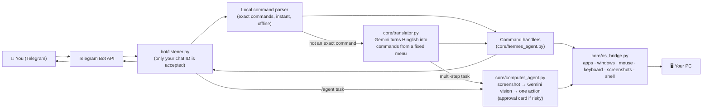

# 🤖 TG-System-Control (Hermes Desktop Agent)

Control your PC from your phone through a private Telegram bot — open and close apps, take screenshots, check CPU/RAM/disk, run commands, send files both ways, and talk to it in **Hinglish or English**. With **agent mode** (`/agent <task>`) the AI looks at your screen and clicks and types step by step to do almost anything you could do at the desk — and asks you before anything risky.

---

## 📖 About

TG-System-Control is a small Python program that runs **on your own computer** and listens to **your** Telegram bot. You send a message from your phone ("spotify kholo", "screenshot", "edge band karo"), the program does it on the PC and replies with the result.

- **Who it's for:** anyone who wants to check on or drive their workstation while away from the desk — creators running long renders, developers, people who leave a PC on at home.
- **What it is not:** a cloud service. Nothing runs on a server; your PC talks directly to the Telegram Bot API (and, if you enable it, to Google Gemini for translating free text).

### How it works



For normal messages the AI is **only a translator**: it answers with commands from a fixed menu (open, close, screenshot, type, …), the bot validates them and runs them through the same code as typed commands. It can't run shell commands there — `/exec` only runs what *you* type.

**Agent mode** is the "do anything" path: for `/agent <task>` (or when the translator decides your message needs several on-screen steps), a vision model sees screenshots and chooses one action at a time. Every action is validated, risky ones wait for your ✅, and `/stop` ends it instantly.

### Privacy

- Runs locally. Your bot token and keys stay in `.env` (git-ignored).
- Memory (`data\notes.json`, `data\conversation.jsonl`) stays on your PC (git-ignored); notes and the last few messages are sent to the AI with messages that aren't exact commands, and notes are sent with agent tasks.
- Every action is appended to `memory.md` on your PC (git-ignored, never uploaded).
- What leaves your PC: messages/screenshots/files you ask the bot to send to Telegram, and — only for messages that aren't exact commands — the message text sent to your chosen AI provider (Gemini / OpenRouter / Groq).
- **In agent mode, screenshots of your whole screen (all monitors) are sent to Google Gemini** at every step, plus the titles of open windows and the output of any commands/files the agent reads. Close anything private before starting a task.
- Files you send to the bot are saved in `INBOX_DIR` on your PC.

---

## 🤖 Two bots, two jobs

| | Bot 1 — **TG-System-Control** (this project, "Hermes agent") | Bot 2 — **Video Studio bot** (`D:\VideoStudio_Mac`) |
|---|---|---|
| Purpose | Control the PC: apps, mouse/keyboard, screenshots, files, agent tasks | Talk to the video pipeline (Antigravity): stages, ★ approvals, render alerts |
| Token | `.env` → `TELEGRAM_BOT_TOKEN` | `tools\.telegram_config.json` → `bot_token` |
| Runs as | `main.py` (start_agent / autostart) | `tools\videostudio_bot.py` — **starts automatically with bot 1** (`STUDIO_AUTOSTART=true`); stop/start any time from bot 1 with `/studio stop` · `/studio start` |
| Memory | `/remember`, `/memory`, `/forget` + recent conversation (`data\`) | `/remember`, `/memory`, `/forget` + full chat history; Antigravity sees it with every message |

**Typical flow:** in bot 1 send *"start antigravity and video generation in a new session"* → bot 1 opens Antigravity and starts a new conversation in the pipeline project with the assistant brief + your task → in bot 2 Antigravity says the session is ready, then works through the pipeline: replies to your messages, sends stage updates, contact sheets, thumbnails, files and screenshots, and asks for ★ approvals with ✅/❌ buttons (recorded by the pipeline's own `gate.py`).

**Reactions on your bot 2 messages:** 👀 = Antigravity will get it now · 💤 = nobody is listening yet (bot 1 / the Antigravity session is off — the message is queued and delivered later) · ✍ note saved. These are status marks, not replies. The bridge waits while you're using the PC (4 s without keyboard/mouse; never longer than 5 min) so it doesn't grab your mouse mid-action.

**Approvals don't block Antigravity:** it sends ★ approvals with `telegram_bot.py approve <video> <stage> --async`; the Video Studio bot records your tap with `gate.py approve` and messages Antigravity `[APPROVAL APPROVED/REJECTED] …`. The old blocking `approve` still works.

**Who answers bot 2?** Antigravity — the desktop app. Bot 2 only queues your messages (👀). Bot 1's **Antigravity bridge** types each one into a dedicated *Telegram* conversation of the pipeline project (`ANTIGRAVITY_PROJECT`, default *CannonBreak Channel*) in the Antigravity desktop app, waiting while Antigravity is still busy with the previous message. Antigravity follows `GEMINI.md` and the pipeline rules and answers you itself with `tools/telegram_bot.py send`. The bridge stays out of the way when an Antigravity session already listens by itself (`wait_for_telegram_msg.py`) and while an `/agent` task uses the mouse. Bot 2 also shows 🟢/🔴 ONLINE/OFFLINE (pinned notice + profile); bot 1 reports it if bot 2 crashes.

The two never share a token: one bot may only be read by one program, otherwise messages get stolen or answered twice. TG-System-Control never edits the pipeline's content, gates or rules — `/studio` only starts/stops the Video Studio bot service and reads its status and log.

## ✨ What's new (v2.0)

- **🧠 Automate anything — `/agent <task>`.** The AI watches the screen and clicks/types/opens/scrolls step by step, sends progress and screenshots, asks you questions when it needs something, and shows ✅/❌ approval cards before risky steps. `/stop` cancels instantly, `/task` shows progress.
- **🖥️ Remote-desktop controls.** `/grid` shows the screen with an x/y ruler and the mouse marked; then `click X Y`, `rclick`, `dclick`, `move`, `drag`, `scroll` — and a fresh screenshot comes back after every mouse/keyboard command, so you can drive the PC step by step like a remote desktop.
- **📤 Upload files into websites.** Send a file to the bot, click the site's *Upload* button, then `/uploadfile <name>` fills the Windows file picker (the agent can do this too).
- **🔒 Block the PC's own mouse/keyboard** with `/block 10` / `/unblock` (admin mode), and reliable typing: waits for the window to be ready, never types into the wrong window.
- **📥 Files both ways.** Send a photo or file to the bot → saved on the PC; `/get <path>`, `/sendfile`, `/latest` send files to your phone.
- **🎛️ More controls:** `/clip`, `/volume`, `/media`, `/scroll`, `/windows`, `/sleep`, `/restart`, `/shutdown` (with approval).
- **Hinglish / free text → real commands.** "spotify kholo aur edge band karo" runs `open spotify` then `close edge`, and the bot tells you *"Understood as: …"*. Feedback or questions get a reply and **nothing is executed**.
- **Reliable open/close.** `open edge`, `open notepad`, `notepad open karo` launch instantly (no AI). `open python` no longer opens YouTube; `open google chrome` opens Chrome. Unknown apps get a clear "not found".
- **Safe closing.** `close edge` closes Edge only (not WebView2, Explorer, or your terminal). If the app isn't running you get "not running" — no random Alt+F4.
- **All hotkeys work:** `ctrl+w`, `ctrl+shift+o`, `alt+f4`, `win+m`, `f5`, …
- **New commands:** `/focus`, `/chatgpt`, `/sendfile`, `/latest`.
- **Security:** the bot refuses to start without `TELEGRAM_CHAT_ID`; button presses are checked too.
- **Clean stops:** one 🔴 OFFLINE message on Ctrl+C, `stop_agent.bat`, `pkill`, Windows shutdown/logoff (also in silent mode).
- **No more duplicate replies:** one instance per bot token, and a warning if something else polls the same bot.
- **Works on Python 3.10+**, launchers find your `.venv` automatically, basic Linux support.

See the [Changelog](#-changelog) for the full list.

---

## 🚀 Quick start

### Prerequisites
- Python **3.10+** and Git
- A Telegram account
- Optional: a free [Google AI Studio](https://aistudio.google.com/app/apikey) key for Hinglish / free text

### 1. Clone and install
```bash
git clone https://github.com/your-username/tg-system-control.git
cd tg-system-control
python -m venv .venv
# Windows:      .\.venv\Scripts\activate
# macOS/Linux:  source .venv/bin/activate
pip install -r requirements.txt
```

### 2. Create your bot and find your chat ID
1. In Telegram open **[@BotFather](https://t.me/BotFather)** → `/newbot` → choose a name and a username ending in `bot`. Copy the **token** (looks like `1234567890:AAE…`). Keep it secret.
2. Open **[@userinfobot](https://t.me/userinfobot)** → `/start`. Copy your numeric **Id**.
3. Open your new bot and press **Start** once.

### 3. Configure `.env`
```bash
cp .env.example .env      # Windows: copy .env.example .env
```
Fill in at least `TELEGRAM_BOT_TOKEN`, `TELEGRAM_CHAT_ID`, and (optional) `GEMINI_API_KEY`.

| Variable | Required | Default | Meaning |
|---|---|---|---|
| `TELEGRAM_BOT_TOKEN` | ✅ | — | Token from @BotFather |
| `TELEGRAM_CHAT_ID` | ✅ | — | Your numeric user ID. Only this chat can control the PC; the bot won't start without it |
| `LLM_PROVIDER` | | `offline` | `gemini`, `openrouter`, `groq`, or `offline` |
| `GEMINI_API_KEY` | for gemini | — | Google AI Studio key |
| `GEMINI_MODEL` | | built-in list | Comma-separated Gemini models to try first |
| `OPENROUTER_API_KEY` | for openrouter | — | OpenRouter key |
| `OPENROUTER_MODEL` | | `nousresearch/hermes-3-llama-3.1-70b` | Any OpenRouter model, e.g. `anthropic/claude-3.5-sonnet` |
| `GROQ_API_KEY` | for groq | — | Groq key (uses `llama-3.3-70b-versatile`) |
| `HERMES_APP_PATH` | | `D:\git-data\hermes-agent\…\Hermes.exe` | Path used by `open hermes` |
| `AGENT_ENABLED` | | `true` | Agent mode (`/agent`). Needs `GEMINI_API_KEY` |
| `AGENT_MODEL` | | `gemini-flash-lite-latest`, then `gemini-flash-latest` | Comma-separated Gemini vision model(s) to try first |
| `AGENT_MAX_STEPS` | | `30` | Max actions per task |
| `AGENT_REQUIRE_APPROVAL` | | `true` | ✅/❌ before risky steps. Keep it on |
| `APPROVAL_TIMEOUT_SEC` | | `300` | Unanswered approvals/questions are cancelled after this |
| `INBOX_DIR` | | `~/Downloads/TelegramInbox` | Where files you send to the bot are saved |
| `UIA_BACKEND` | | `auto` | `powershell` forces the old element-listing helper (blind to classic Win32 controls) |
| `TYPE_METHOD` | | `paste` | `paste` (clipboard + Ctrl+V, reliable) or `keys` (key by key; use if a field blocks pasting) |
| `REMOTE_FEEDBACK` | | `true` | Screenshot after every mouse/keyboard command |
| `STUDIO_AUTOSTART` | | `true` | Start the Video Studio bot whenever this bot starts |
| `ANTIGRAVITY_BRIDGE` | | `true` | Type Video Studio bot messages into the Antigravity desktop app |
| `ANTIGRAVITY_PROJECT` | | `CannonBreak Channel` | Antigravity project (sidebar name) that holds the pipeline |
| `ANTIGRAVITY_EXE` | | `%LOCALAPPDATA%\Programs\Antigravity\Antigravity.exe` | Antigravity desktop app |
| `ANTIGRAVITY_BUSY_WAIT_SEC` | | `900` | How long to wait for Antigravity to finish the previous message |
| `VIDEOSTUDIO_DIR` | | `D:\VideoStudio_Mac` | Video pipeline folder for `/studio` |
| `VIDEOSTUDIO_PYTHON` | | `<VIDEOSTUDIO_DIR>\.venv\Scripts\pythonw.exe` | Python used to run the Video Studio bot |

If the selected provider has no key, the bot runs in **offline mode**: exact commands work, free text gets the help menu. Agent mode always uses Gemini, so it needs `GEMINI_API_KEY` even if `LLM_PROVIDER` is something else.

### 4. Verify
```bash
python setup_check.py
```
Every line should be `✅ PASS`. It checks Python, packages, `.env` (placeholders fail), screenshots, shell, and that your token works.

### 5. Run
| | Windows | macOS / Linux |
|---|---|---|
| With a console | double-click `start_agent.bat` | `python3 main.py` |
| Silent / background | double-click `start_agent_silent.vbs` | `nohup python3 main.py >/dev/null 2>&1 &` |
| Start on boot | `install_autostart.bat` | `bash install_autostart_mac.sh` / `bash install_autostart_linux.sh` |
| Stop | `stop_agent.bat` | `pkill -f "tg-system-control/main.py"` or `systemctl --user stop tg-system-control` |
| Remove autostart | `uninstall_autostart.bat` | see [SETUP.md](SETUP.md#-8-automatic-startup-on-boot) |

When everything is warmed up you get **🟢 SYSTEM ONLINE** in Telegram. Send `/help`.

### 🛡️ Run as administrator (recommended)

Windows only lets programs running **as administrator**:
- block the PC's own mouse/keyboard (`/block`, and while the bot clicks/types), and
- click/type into admin windows (Task Manager, admin terminals, installers, UAC-elevated apps).

Run **`install_autostart_admin.bat`** once and click **Yes** on the Windows prompt. It registers a scheduled task that starts the bot at every logon with admin rights (no prompt at boot), removes the normal Startup shortcut, and restarts the bot as admin. Start it manually any time with `schtasks /Run /TN TGSystemControl`; remove it with `uninstall_autostart.bat`. `setup_check.py` and the 🟢 ONLINE message show whether the input lock is available.

What admin mode can't do: control the Windows lock screen, the UAC "Yes/No" secure desktop, or Ctrl+Alt+Del screens (Windows blocks all programs there; Ctrl+Alt+Del at the PC also always cancels `/block`).

### Updating to a new version
```bash
git pull
pip install -r requirements.txt
```
Then restart the bot (`stop_agent.bat` → `start_agent.bat`, or `systemctl --user restart tg-system-control`). Code changes only take effect after a restart.

### 💡 Setup prompt for AI coding agents (Antigravity, Claude, Cursor)
```text
Please read the SETUP.md file, set up this project on my computer with Bot Token: <YOUR_BOT_TOKEN> and Chat ID: <YOUR_CHAT_ID>, and configure the AI engine to be powered by <"specify model: e.g., gemini / claude / openrouter / offline">.
```

---

## ⬆️ Upgrading from v1

1. **Stop the old bot** with the new `stop_agent.bat` (it also finds bots started by the old launchers).
2. **Rotate your bot token if it was ever committed or shared:** @BotFather → `/mybots` → your bot → *API Token* → *Revoke current token*, then put the new token in `.env`. Old tokens stay readable in git history forever.
3. Check `.env` against the new `.env.example` (new optional keys: `GEMINI_MODEL`, `HERMES_APP_PATH`, `AGENT_*`, `APPROVAL_TIMEOUT_SEC`, `INBOX_DIR`). `TELEGRAM_CHAT_ID` is now mandatory.
4. Run `python setup_check.py`, then start the bot again.

---

## ⌨️ Command reference

Exact commands run instantly and work offline. Anything else is translated by the AI (if configured).

| What | Commands (examples) |
|---|---|
| Help | `/help`, `help`, `menu` |
| System status | `status`, `/status`, `pc status`, `ram`, `cpu`, `disk` |
| Screenshot | `screenshot`, `/shot`, `ss`, `ss bhejo`, `screen dikhao` |
| Open app / website | `open spotify`, `/open edge`, `launch notepad`, `edge kholo`, `notepad open karo`, `open youtube studio`, `open edge gmail app`, `open https://example.com` |
| Close app | `close spotify`, `/close edge`, `kill notepad`, `edge band karo`, `chrome hatao` |
| Close tab / window | `close tab`, `close youtube studio` (finds that tab's window), `close window`, `hatao`, `band karo` (Alt+F4) |
| Processes | `processes`, `/proc` |
| Lock screen | `lock pc`, `/lock`, `pc lock karo` |
| Run a command | `/exec Get-ChildItem ~\Downloads`, `/run ls -la` (PowerShell on Windows, Bash elsewhere) |
| Type | `/type hello world`, `type: hello` |
| Type + Enter | `/prompt what is 2+2`, `prompt: …` |
| Keys | `press enter`, `/key esc`, `/key f5` |
| Hotkeys | `/hotkey ctrl+w`, `/hotkey ctrl+shift+t`, `/hotkey alt+tab`, `/hotkey win+d` |
| **Remote desktop** | `/grid` (screenshot with x/y ruler, 🔴 = mouse) · `/shot` · `/where` (mouse position) |
| Mouse | `click 960 540`, `rclick X Y`, `dclick X Y`, `click` (at current position), `move X Y`, `drag X1 Y1 X2 Y2`, `scroll down 5`, `scroll up` |
| Remote view | after every mouse/keyboard command a screenshot is sent back; `/remote off` / `/remote on` |
| Upload into a website | send the file to the bot → click the site's *Upload / Choose file* button → `/uploadfile photo.png` |
| Block local input | `/block 10` (minutes) · `/unblock` — needs [admin mode](#-run-as-administrator-recommended) |
| Focus a window | `/focus chatgpt`, `/focus notepad` |
| ChatGPT | `/chatgpt write 3 youtube title ideas about Luffy` (opens Edge → new chat → paste → Enter → screenshot) |
| Send files to phone | `/latest` (newest file in Downloads), `/sendfile report.pdf`, `send file C:\path\to\file.zip` |
| Free text / Hinglish | `spotify kholo aur edge band karo`, `chrome band kar do`, `screen ka photo bhejo` |
| **Agent: do anything** | `/agent <task>`, `/do <task>` — see [Automate anything](#-automate-anything-agent-mode) |
| Agent control | `/task` (progress), `/stop` / `ruko` (cancel now) |
| Files from phone → PC | send any photo/document (≤ 20 MB) → saved to `INBOX_DIR`; add a caption to run it as a command (`{file}` = saved path) |
| Files PC → phone | `/get C:\path\to\file.pdf` (asks approval outside your personal folders) |
| Clipboard | `/clip` (read), `/clip some text` (write) |
| Volume / media | `/volume up`, `/volume mute`, `/media play`, `/media next` |
| Scroll / windows | `/scroll down`, `/windows` |
| Power | `/sleep`, `/restart`, `/shutdown` (always ask ✅ first; restart/shutdown wait 15 s) |
| **Thumbnails** | `/thumbnails luffy marineford p2` (or an idea, or nothing = the READY_TO_UPLOAD video). **Antigravity** (it has the script) writes **5 prompts** — anime style, any text only in white/light-grey and red — into the video's `thumbnail` folder and sends them in the Video Studio bot; then ChatGPT in your real Edge generates them **one at a time**. After each image bot 1 checks that a **new, different** image really arrived (a re-download of an earlier one counts as missing; one retry with *Save image as*), saves it with a YouTube-ready 1280×720 JPG (< 2 MB) and sends it to you |
| **YouTube upload** | `/ytupload check` — read + verify `READY_TO_UPLOAD\METADATA_COPY_PASTE.txt` (title ≤ 100, description ≤ 5000, tags ≤ 500, files exist, thumbnail ≤ 2 MB, schedule in the future). `/ytupload` — asks ✅, then uploads in your real Edge/YouTube Studio: file, title, description, thumbnail, not-for-kids, tags, location, schedule; **asks ✅ again before the final Schedule/Save click**. The upload only counts as done when a real YouTube video link comes back — otherwise you're told it's unconfirmed. The AI-disclosure (altered content) setting is never touched — you set it yourself |
| **New pipeline session** | `/studio session <task>` — opens Antigravity, starts a NEW conversation in the pipeline project with your task, makes sure the Video Studio bot is online; Antigravity then works and talks to you in the Video Studio bot. Hinglish: *"antigravity me naya session start karo aur video generation shuru karo"* |
| **Stop both bots** | `/stopall` (each bot posts 🔴 OFFLINE). On the PC: `stop_all_bots.bat` / `start_all_bots.bat` (the Desktop shortcut *Start TGControl* runs the latter) |
| **Video Studio bot** | `/studio start` · `/studio stop` · `/studio restart` · `/studio status` · `/studio logs` · Hinglish: *"video studio bot chalu karo"* |
| **Memory** | `/remember my videos are in D:\VideoStudio_Mac` · `yaad rakhna: …` · `/memory` · `/forget 2` · `/forget thumbnails` · `/forget all`. Follow-ups like *"usko band karo"* use the recent conversation |

---

## 🧠 Automate anything (agent mode)

```text
/agent chatgpt me luffy ke 3 thumbnail banao aur download karke bhejo
/do downloads me sabse badi file bhejo
/agent open notepad and type hello
/agent youtube studio kholo aur latest video ke views ka screenshot bhejo
/agent find yesterday's invoice PDF in Downloads and send it to me
```

**How it works**
1. You send a task (or the translator decides your message needs several on-screen steps).
2. Each turn the bot reads the **list of buttons, fields, links and menus** of the active window from Windows (UI Automation — the technique used by Microsoft UFO / Windows-MCP), draws their numbers on a screenshot, and sends both to Gemini with the task and the steps so far.
3. Gemini answers with **1–5 actions** at once, preferably by element number (`type_text` into element 5, `press_key enter`, `click` element 12). Element clicks hit the exact centre Windows reports; pixel coordinates are only a fallback for things not in the list.
4. Each action is validated (known action, existing element number / on-screen coordinates, valid keys) and checked against the safety rules, then executed.
5. A single progress message is updated in the background (with how long each AI turn took); a screenshot arrives every 5 turns and at the end with the result and total time.

**While it runs**
- `/task` — what it's doing · `/stop` — cancel immediately (also releases any input lock).
- Read-only commands (`status`, `screenshot`, `/sendfile` …) still work; commands that use the mouse/keyboard are refused until the task ends. New `/agent` tasks are queued.
- If it asks a question, just reply with the answer.

**Tips**
- Be specific: which app, what to type, what to send back.
- Log in to websites yourself first — the agent will never type passwords or codes.
- Start with something harmless (`/agent open notepad and type hello`) to see how it behaves on your screen.

**Speed** (measured on a Windows 11 laptop, free Gemini key)
- "Type *speed test ok* in Notepad": **5.6 s** (1 AI turn, 2 actions).
- "Open google.com in Edge and search for …": **~25 s** (3 AI turns, 4 actions).
- Models that are overloaded or not answering are skipped for 3 minutes (discontinued ones for a day) instead of costing time on every turn; each AI call waits at most ~25 s.
- Text is typed by pasting (`TYPE_METHOD=paste`), which stays correct when the PC is busy.

**Limits**
- Each AI turn is one Gemini request with a screenshot (typically 3–6 s); the free Gemini tier has daily limits and is sometimes overloaded, so long tasks can be slow or run out of quota.
- Apps that don't expose UI Automation (games, some canvas-based web apps) fall back to pixel coordinates, which are less precise.
- It can misclick or misunderstand — that's why risky steps need your approval. Watch the progress and use `/stop`.
- Max `AGENT_MAX_STEPS` (default 30) steps per task. Windows is the supported platform for agent mode.

---

## 🛡️ Safety & security

- **Chat-ID lock:** only `TELEGRAM_CHAT_ID` can send commands or press buttons. Everyone else gets *Access Denied* (logged in `memory.md`). The bot refuses to start without it.
- **The translator can't run shell commands.** It only picks from a fixed menu; anything else it returns is dropped. `/exec` runs exactly what you type — treat it like an open terminal.
- **Agent approvals (✅/❌ cards)** are required before: shell commands that aren't clearly read-only, deleting/moving files, closing apps (unsaved work), Alt+F4, reading or sending files outside your personal folders or that look like secrets (`.env`, SSH keys, password files), and any click/Enter that looks like *send, post, buy, pay, order, delete, install, uninstall, confirm, sign out…*, plus anything the model itself flags as risky. Unanswered cards are cancelled after `APPROVAL_TIMEOUT_SEC`. Only your chat ID can press the buttons.
- **Never typed by the agent:** payment card numbers, one-time codes/PINs, passwords — it asks you to do those steps yourself.
- **Power actions** (`/sleep`, `/restart`, `/shutdown`) always ask first.
- **Protected processes:** `close` never kills Explorer, WebView2, system processes, Python or PowerShell.
- **Input lock:** while the bot types/clicks it can block your physical mouse/keyboard so you don't interfere — Windows only allows this when the bot runs **as administrator**; otherwise it just isn't locked (the reply tells you).
- **Token hygiene:** never commit `.env`, never paste your token in chats or screenshots, revoke it in @BotFather if it leaks. Anyone with the token can read what you send to the bot.
- **Don't** add other people's chat IDs, run the bot as admin unless you need the input lock, or expose your PC to strangers via `/exec`.

---

## 🖥️ Platform support

| Feature | Windows | macOS | Linux (X11) |
|---|---|---|---|
| Status, screenshot, `/exec`, lock, processes | ✅ | ✅ | ✅ (screenshot via Pillow / gnome-screenshot / scrot / grim) |
| Open apps / websites | ✅ (Start-menu catalog, Store & PWA apps) | ✅ `open -a` | ✅ PATH / `gtk-launch` / `xdg-open` |
| Close apps | ✅ | ✅ `pkill -x` | ✅ `pkill -x` |
| Type, keys, hotkeys, click | ✅ | ⚠️ AppleScript (needs Accessibility permission); clicks need `cliclick` | ⚠️ needs `xdotool` |
| Focus windows | ✅ | ✅ | ⚠️ needs `wmctrl` |
| `/chatgpt` automation | ✅ | ❌ (opens ChatGPT only) | ❌ (opens ChatGPT only) |
| OFFLINE on shutdown/logoff | ✅ best-effort | ✅ via signals | ✅ via systemd stop |
| Input lock | ✅ (admin only) | ❌ | ❌ |
| Agent mode (`/agent`) | ✅ | ⚠️ experimental (needs the tools above) | ⚠️ experimental (X11 + `xdotool`) |
| Files to/from phone, `/clip`, `/volume`, `/media` | ✅ | ✅ (volume via AppleScript) | ✅ (needs `xclip`/`xdotool`) |

Windows is the main, tested platform. macOS and Linux code paths are written but were not tested on real machines for this release.

---

## 🧰 Troubleshooting & FAQ

- **Bot doesn't reply** — run `python setup_check.py`; make sure you pressed *Start* in your bot; check that `TELEGRAM_CHAT_ID` is *your* ID (from @userinfobot), not the bot's.
- **Every reply comes twice** — two copies are polling the same bot. Run `stop_agent.bat`, then start once. The bot now refuses a second local copy and logs a *409 Conflict* warning if another machine uses the same token.
- **Black or empty screenshots** — the PC is locked or the bot runs in a non-interactive session (e.g. a service). Start it from your logged-in desktop (autostart does this).
- **"App not found"** — try the name shown in the Start menu (`open visual studio code`), or `/exec Start-Process "path\to\app.exe"`. The app list refreshes automatically once per run when a name isn't found.
- **AI translator errors / quota** — free Gemini keys have daily limits. Exact commands keep working; try again later or switch `LLM_PROVIDER`.
- **"Your mouse/keyboard were not locked" / `/block` says it needs admin** — run `install_autostart_admin.bat` (see *Run as administrator*).
- **Typing went into the wrong place or stopped** — the bot waits for the window to be ready and stops if another window takes focus. Click the text box first (`/grid` → `click X Y`) and send the text again.
- **Clicks/typing do nothing in Task Manager or an admin window** — Windows blocks non-admin programs from controlling admin windows; use admin mode.
- **`/uploadfile` says no file picker is open** — click the website's *Upload / Choose file / Attach* button first (the Windows *Open* dialog must be visible), then send `/uploadfile` again.
- **Clicked the wrong spot** — coordinates are real screen pixels. Use `/grid` (labels `x…`/`y…`) and check the 🔴 marker on the screenshot that comes back.
- **No OFFLINE message after shutdown** — it's best-effort: if Windows cuts the network first, the message can't be sent.
- **`stop_agent.bat` says force-stopped** — the bot didn't exit in 10 s (or was an old v1 instance), so no OFFLINE message was sent.
- **Agent mode is OFF at startup** — set `GEMINI_API_KEY` and `AGENT_ENABLED=true`, then restart. `setup_check.py` shows its status.
- **Agent clicks the wrong place** — keep display scaling consistent, don't move the mouse during a task (or run as admin so input is locked), and give more specific instructions. `/stop` anytime.
- **"The agent is using the mouse/keyboard right now"** — a task is running; wait, `/stop` it, or use read-only commands.
- **Approval card says expired** — it timed out (`APPROVAL_TIMEOUT_SEC`) or the task was stopped.

---

## 📁 Project structure

```text
tg-system-control/
├── .env.example              # Configuration template (copy to .env)
├── requirements.txt          # requests, Pillow
├── setup_check.py            # Environment verification
├── config.py                 # Loads .env / environment variables
├── main.py                   # Entry point: single-instance lock, lifecycle hooks, supervisor
├── bot/
│   ├── telegram_client.py    # Bot API: messages, photos, documents, buttons, downloads
│   └── listener.py           # Polling, authorization, command worker, approvals, questions, uploads
├── core/
│   ├── hermes_agent.py       # Local command parser + command handlers
│   ├── translator.py         # AI translator (Hinglish/free text -> fixed command menu)
│   ├── computer_agent.py     # Agent mode: screenshot + element list -> AI -> 1-5 validated actions
│   ├── ui_elements.py        # Numbered buttons/fields of the active window (UI Automation 3, PowerShell fallback)
│   ├── ui_actions.py         # Click/type: native controls directly, browsers with real mouse + paste, read-back
│   ├── ocr.py                # Windows built-in OCR for the click_text fallback
│   ├── conversation_memory.py # /remember notes + recent conversation for the AI
│   ├── studio_control.py     # /studio: start/stop/status of the Video Studio bot (bot 2), ONLINE/OFFLINE watch
│   ├── antigravity_bridge.py # Video Studio messages -> Antigravity desktop app (it replies via bot 2)
│   ├── agent_safety.py       # Approval rules, read-only shell allowlist, never-type rules
│   ├── llm_router.py         # Gemini / OpenRouter / Groq / offline
│   ├── os_bridge.py          # Apps, windows, mouse, keyboard, screenshots, shell
│   ├── system_lifecycle.py   # ONLINE/OFFLINE, shutdown & stop hooks, single instance
│   └── memory_logger.py      # Append-only memory.md log
├── start_agent.bat / start_agent_silent.vbs / stop_agent.bat
├── install_autostart.bat / uninstall_autostart.bat
├── install_autostart_admin.bat (+ .ps1)  # Start at logon as administrator (scheduled task)
├── install_autostart_mac.sh / install_autostart_linux.sh
├── install_hermes_app.bat    # Optional: Nous Research Hermes desktop app
└── temp/, screenshots/, memory.md   # local only, git-ignored
```

`temp/*.py` scripts from earlier experiments (hard-coded window handles and pixel positions) are superseded by `/chatgpt`, `/sendfile` and `/latest`.

---

## 🤝 Contributing

Issues and pull requests are welcome. Please run `python setup_check.py` before submitting, keep the AI on the "translator only" path (no direct execution of model output), and never commit `.env`, `memory.md`, `screenshots/` or `temp/`.

---

## 📝 Changelog

### v2.8
- **Own Python environment:** tg-system-control now has its own `.venv` (`requests`, `Pillow`, `uiautomation`; git-ignored). The launchers pick it automatically, so the video pipeline's Python is no longer borrowed and stays free of these packages. Recreate it anywhere with `python -m venv .venv` + `pip install -r requirements.txt`.
- **Better desktop UI usage, built only on what was tested:**
  - Element listing now uses UI Automation 3 (COM, `uiautomation` package): classic Win32 / WinForms / WPF windows, which the old PowerShell helper saw as untyped "panes" (**0 controls**), are listed with real types (10 of 10 in the test window); Antigravity identical; Edge finds more. Same speed (tens of ms). The PowerShell helper stays as a fallback (`UIA_BACKEND=powershell` forces it).
  - **Native Windows apps:** buttons, checkboxes and list items are acted on directly (Invoke / Toggle / Select, 1-25 ms, no mouse movement); plain text boxes use SetValue with read-back.
  - **Browsers and Electron apps (Edge, Chrome, Antigravity): real mouse clicks and Ctrl+V, on purpose.** Measured: an invoked click does not open a file picker (browsers need a real user action), rich text boxes (ChatGPT style) show set text but never get the `input` event, Antigravity ignores SetValue. Note: acting on a control can still bring its window to the front - it is not background operation.
  - **Typed text is read back** from the field; the agent is told "verified", "could not verify" or "the field does NOT show this text".
  - **OCR fallback:** new agent action `click_text` finds text on screen with Windows' built-in OCR (no install, ~1.5 s) when a control has no accessible name. It obeys the same approval and final-button rules as normal clicks.

### v2.7
- Thumbnails: Antigravity writes the 5 prompts (it has the script); ChatGPT generates them one at a time; each image must be NEW (content hash), with one retry; delivered one by one.
- `/ytupload` result is verified by code: a real YouTube link is required to call it done.
- Non-blocking approvals (`approve --async`), "nobody listening" 💤 reaction on bot 2, bridge heartbeat, bridge waits while you use the PC.
- `/stopall`, `stop_all_bots.bat`, `start_all_bots.bat` (clean shutdown with OFFLINE notices); Desktop shortcut fixed; dead Startup script removed.
- Gemini: a brief connection drop is retried once before switching model. Antigravity is told not to edit `tools/` on its own.

### v2.6
- `/thumbnails`: ChatGPT writes 5 prompts (anime, white/grey + red text), then generates one at a time; every download is verified by code (retry with *Save image as*), YouTube-ready JPGs, sent to the phone.
- `/ytupload` + `/ytupload check`: METADATA_COPY_PASTE.txt parser/validator, real-Edge YouTube Studio upload with ✅ before start and before the final Schedule/Save button (enforced for any button with that name). AI disclosure left to the owner.
- Agent: per-task step limits, follow-up hooks, pre-approved files, "confirm buttons", task-specific expected words (no approval spam for sending a prompt); risky-word checks use the agent's intent, not the typed text.

### v2.5
- `/studio session <task>`: start Antigravity + a new pipeline session connected to the Video Studio bot (assistant brief: updates, images, files, screenshots, ★ approvals via the pipeline's own CLI).
- Session tracking survives Antigravity renaming conversations; one writer into the Antigravity window at a time.

### v2.4
- Antigravity bridge: Video Studio bot messages are typed into the Antigravity desktop app, which answers via bot 2.
- Video Studio bot ONLINE/OFFLINE indicator (pinned notice + profile), crash and PC-shutdown notices from bot 1.
- Video Studio bot auto-starts with bot 1 (`STUDIO_AUTOSTART`); per-bot update offsets (safe token changes).

### v2.3
- Two-bot setup: `/studio start|stop|restart|status|logs` controls the separate Video Studio bot service in the video pipeline folder.
- Memory: `/remember`, `/memory`, `/forget`; recent conversation + notes are given to the AI translator (follow-ups like "usko band karo") and notes to the agent.
- Pronouns ("usko", "it", "wahi wala") are no longer mistaken for app names.

### v2.2
- Agent is much faster and more accurate: reads the active window's buttons/fields via Windows UI Automation and clicks them by number (exact centres), up to 5 actions per AI call, smaller screenshots, background progress updates, measured times in replies.
- Overloaded / timed-out / discontinued Gemini models are skipped automatically (cooldowns) with a ~25 s cap per call; `gemini-2.5-flash` removed from defaults.
- Typing pastes via the clipboard by default (`TYPE_METHOD`), restoring your clipboard text afterwards; native clipboard read (~1 ms).
- The bot no longer answers its own "pinned message" notice with "Access Denied" at startup.

### v2.1
- Remote-desktop controls: `/grid`, cursor-marked screenshots after every mouse/keyboard command (`/remote on|off`), `rclick`, `dclick`, `move`, `drag`, `scroll down N`, `/where`.
- Upload into websites: `/uploadfile <name>` fills the Windows file picker; agent action `upload_file`; the agent knows the files you sent.
- Input blocking fixed (all `BlockInput` calls on one thread so `/stop`, `/unblock` and timers can release it); `/block N` / `/unblock`; `install_autostart_admin.bat` runs the bot as administrator.
- Typing fixed: no more lost/garbled characters (waits until the window is ready, no Alt-tap when focusing windows, stops if focus changes); opening an app waits for its window; `/prompt` never presses Enter if typing failed.

### v2.0
- **Agent mode** (`/agent`, `/do`): Gemini-vision computer-use loop with validated actions, coordinate scaling for high-DPI and multi-monitor, approval cards, never-type rules, ask-the-user, `/stop`, `/task`, task queue, progress edits and screenshots.
- Files from phone saved to `INBOX_DIR`; `/get`, `/clip`, `/volume`, `/media`, `/scroll`, `/windows`, `/sleep`, `/restart`, `/shutdown` (approval).
- Commands now run on a worker thread so `/stop`, approvals and answers are handled instantly.
- Hinglish/free-text translator with a fixed command menu, "Understood as" replies, and no execution for chat/feedback; old free-form AI tool execution removed.
- Exact-phrase local parser (fixes `open X` going to the AI, `open telegram` showing status, `/exec git status` showing status, etc.).
- `launch_app`: whole-word website shortcuts, exact app names first, clear "not found", one automatic app-list refresh.
- `close_app`: exact process names, protected system processes, "not running" instead of Alt+F4, tab closing by window title, PowerShell injection-safe.
- Generic hotkey parser (any ctrl/alt/shift/win combination, F-keys, media keys); `win+m` fixed.
- Unicode-safe typing via `SendInput`; long text pasted via clipboard.
- Mandatory `TELEGRAM_CHAT_ID`; callback buttons authorized.
- OFFLINE sent exactly once (Ctrl+C, SIGTERM/SIGBREAK, stop flag, shutdown/logoff window listener); `stop_agent.bat` rewritten.
- Single instance per bot token (named mutex) + 409 conflict warning + duplicate update guard.
- Network drop/restore and every executed command logged to `memory.md`.
- Python 3.10/3.11 compatibility, UTF-8 safe console output, `.venv`-aware launchers, macOS RAM %, basic Linux support, optional `psutil`.
- Secrets removed from `.env.example` and docs.

### v1.x
- Initial Telegram controller, app catalog, warm-up, autostart scripts, ChatGPT workflow.

---

## 📄 License
MIT License.
