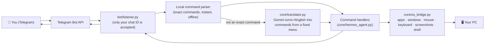

# 🤖 TG-System-Control (Hermes Desktop Agent)

Control your PC from your phone through a private Telegram bot — open and close apps, take screenshots, check CPU/RAM/disk, run commands, type, press keys, and talk to it in **Hinglish or English**.

---

## 📖 About

TG-System-Control is a small Python program that runs **on your own computer** and listens to **your** Telegram bot. You send a message from your phone ("spotify kholo", "screenshot", "edge band karo"), the program does it on the PC and replies with the result.

- **Who it's for:** anyone who wants to check on or drive their workstation while away from the desk — creators running long renders, developers, people who leave a PC on at home.
- **What it is not:** a cloud service. Nothing runs on a server; your PC talks directly to the Telegram Bot API (and, if you enable it, to Google Gemini for translating free text).

### How it works



The AI is **only a translator**. It can answer with commands from a fixed menu (open, close, screenshot, type, …); the bot validates them and runs them through the same code as typed commands. It can never run shell commands — `/exec` only runs what *you* type.

### Privacy

- Runs locally. Your bot token and keys stay in `.env` (git-ignored).
- Every action is appended to `memory.md` on your PC (git-ignored, never uploaded).
- What leaves your PC: messages/screenshots/files you ask the bot to send to Telegram, and — only for messages that aren't exact commands — the message text sent to your chosen AI provider (Gemini / OpenRouter / Groq).

---

## ✨ What's new (v2.0)

- **Hinglish / free text → real commands.** "spotify kholo aur edge band karo" runs `open spotify` then `close edge`, and the bot tells you *"Understood as: …"*. Feedback or questions get a reply and **nothing is executed**.
- **Reliable open/close.** `open edge`, `open notepad`, `notepad open karo` launch instantly (no AI). `open python` no longer opens YouTube; `open google chrome` opens Chrome. Unknown apps get a clear "not found".
- **Safe closing.** `close edge` closes Edge only (not WebView2, Explorer, or your terminal). If the app isn't running you get "not running" — no random Alt+F4.
- **All hotkeys work:** `ctrl+w`, `ctrl+shift+o`, `alt+f4`, `win+m`, `f5`, …
- **New commands:** `/focus`, `/chatgpt`, `/sendfile`, `/latest`.
- **Security:** the bot refuses to start without `TELEGRAM_CHAT_ID`; button presses are checked too.
- **Clean stops:** one 🔴 OFFLINE message on Ctrl+C, `stop_agent.bat`, `pkill`, Windows shutdown/logoff (also in silent mode).
- **No more duplicate replies:** one instance per bot token, and a warning if something else polls the same bot.
- **Works on Python 3.10+**, launchers find your `.venv` automatically, basic Linux support.

See the [Changelog](#-changelog) for the full list.

---

## 🚀 Quick start

### Prerequisites
- Python **3.10+** and Git
- A Telegram account
- Optional: a free [Google AI Studio](https://aistudio.google.com/app/apikey) key for Hinglish / free text

### 1. Clone and install
```bash
git clone https://github.com/your-username/tg-system-control.git
cd tg-system-control
python -m venv .venv
# Windows:      .\.venv\Scripts\activate
# macOS/Linux:  source .venv/bin/activate
pip install -r requirements.txt
```

### 2. Create your bot and find your chat ID
1. In Telegram open **[@BotFather](https://t.me/BotFather)** → `/newbot` → choose a name and a username ending in `bot`. Copy the **token** (looks like `1234567890:AAE…`). Keep it secret.
2. Open **[@userinfobot](https://t.me/userinfobot)** → `/start`. Copy your numeric **Id**.
3. Open your new bot and press **Start** once.

### 3. Configure `.env`
```bash
cp .env.example .env      # Windows: copy .env.example .env
```
Fill in at least `TELEGRAM_BOT_TOKEN`, `TELEGRAM_CHAT_ID`, and (optional) `GEMINI_API_KEY`.

| Variable | Required | Default | Meaning |
|---|---|---|---|
| `TELEGRAM_BOT_TOKEN` | ✅ | — | Token from @BotFather |
| `TELEGRAM_CHAT_ID` | ✅ | — | Your numeric user ID. Only this chat can control the PC; the bot won't start without it |
| `LLM_PROVIDER` | | `offline` | `gemini`, `openrouter`, `groq`, or `offline` |
| `GEMINI_API_KEY` | for gemini | — | Google AI Studio key |
| `GEMINI_MODEL` | | built-in list | Comma-separated Gemini models to try first |
| `OPENROUTER_API_KEY` | for openrouter | — | OpenRouter key |
| `OPENROUTER_MODEL` | | `nousresearch/hermes-3-llama-3.1-70b` | Any OpenRouter model, e.g. `anthropic/claude-3.5-sonnet` |
| `GROQ_API_KEY` | for groq | — | Groq key (uses `llama-3.3-70b-versatile`) |
| `HERMES_APP_PATH` | | `D:\git-data\hermes-agent\…\Hermes.exe` | Path used by `open hermes` |

If the selected provider has no key, the bot runs in **offline mode**: exact commands work, free text gets the help menu.

### 4. Verify
```bash
python setup_check.py
```
Every line should be `✅ PASS`. It checks Python, packages, `.env` (placeholders fail), screenshots, shell, and that your token works.

### 5. Run
| | Windows | macOS / Linux |
|---|---|---|
| With a console | double-click `start_agent.bat` | `python3 main.py` |
| Silent / background | double-click `start_agent_silent.vbs` | `nohup python3 main.py >/dev/null 2>&1 &` |
| Start on boot | `install_autostart.bat` | `bash install_autostart_mac.sh` / `bash install_autostart_linux.sh` |
| Stop | `stop_agent.bat` | `pkill -f "tg-system-control/main.py"` or `systemctl --user stop tg-system-control` |
| Remove autostart | `uninstall_autostart.bat` | see [SETUP.md](SETUP.md#-8-automatic-startup-on-boot) |

When everything is warmed up you get **🟢 SYSTEM ONLINE** in Telegram. Send `/help`.

### Updating to a new version
```bash
git pull
pip install -r requirements.txt
```
Then restart the bot (`stop_agent.bat` → `start_agent.bat`, or `systemctl --user restart tg-system-control`). Code changes only take effect after a restart.

### 💡 Setup prompt for AI coding agents (Antigravity, Claude, Cursor)
```text
Please read the SETUP.md file, set up this project on my computer with Bot Token: <YOUR_BOT_TOKEN> and Chat ID: <YOUR_CHAT_ID>, and configure the AI engine to be powered by <"specify model: e.g., gemini / claude / openrouter / offline">.
```

---

## ⬆️ Upgrading from v1

1. **Stop the old bot** with the new `stop_agent.bat` (it also finds bots started by the old launchers).
2. **Rotate your bot token if it was ever committed or shared:** @BotFather → `/mybots` → your bot → *API Token* → *Revoke current token*, then put the new token in `.env`. Old tokens stay readable in git history forever.
3. Check `.env` against the new `.env.example` (new optional keys: `GEMINI_MODEL`, `HERMES_APP_PATH`). `TELEGRAM_CHAT_ID` is now mandatory.
4. Run `python setup_check.py`, then start the bot again.

---

## ⌨️ Command reference

Exact commands run instantly and work offline. Anything else is translated by the AI (if configured).

| What | Commands (examples) |
|---|---|
| Help | `/help`, `help`, `menu` |
| System status | `status`, `/status`, `pc status`, `ram`, `cpu`, `disk` |
| Screenshot | `screenshot`, `/shot`, `ss`, `ss bhejo`, `screen dikhao` |
| Open app / website | `open spotify`, `/open edge`, `launch notepad`, `edge kholo`, `notepad open karo`, `open youtube studio`, `open edge gmail app`, `open https://example.com` |
| Close app | `close spotify`, `/close edge`, `kill notepad`, `edge band karo`, `chrome hatao` |
| Close tab / window | `close tab`, `close youtube studio` (finds that tab's window), `close window`, `hatao`, `band karo` (Alt+F4) |
| Processes | `processes`, `/proc` |
| Lock screen | `lock pc`, `/lock`, `pc lock karo` |
| Run a command | `/exec Get-ChildItem ~\Downloads`, `/run ls -la` (PowerShell on Windows, Bash elsewhere) |
| Type | `/type hello world`, `type: hello` |
| Type + Enter | `/prompt what is 2+2`, `prompt: …` |
| Keys | `press enter`, `/key esc`, `/key f5` |
| Hotkeys | `/hotkey ctrl+w`, `/hotkey ctrl+shift+t`, `/hotkey alt+tab`, `/hotkey win+d` |
| Mouse click | `click 960 540`, `/click 100 200` |
| Focus a window | `/focus chatgpt`, `/focus notepad` |
| ChatGPT | `/chatgpt write 3 youtube title ideas about Luffy` (opens Edge → new chat → paste → Enter → screenshot) |
| Send files to phone | `/latest` (newest file in Downloads), `/sendfile report.pdf`, `send file C:\path\to\file.zip` |
| Free text / Hinglish | `spotify kholo aur edge band karo`, `chrome band kar do`, `screen ka photo bhejo` |

---

## 🛡️ Safety & security

- **Chat-ID lock:** only `TELEGRAM_CHAT_ID` can send commands or press buttons. Everyone else gets *Access Denied* (logged in `memory.md`). The bot refuses to start without it.
- **The AI can't run shell commands.** It only picks from a fixed menu; anything else it returns is dropped. `/exec` runs exactly what you type — treat it like an open terminal.
- **Protected processes:** `close` never kills Explorer, WebView2, system processes, Python or PowerShell.
- **Input lock:** while the bot types/clicks it can block your physical mouse/keyboard so you don't interfere — Windows only allows this when the bot runs **as administrator**; otherwise it just isn't locked (the reply tells you).
- **Token hygiene:** never commit `.env`, never paste your token in chats or screenshots, revoke it in @BotFather if it leaks. Anyone with the token can read what you send to the bot.
- **Don't** add other people's chat IDs, run the bot as admin unless you need the input lock, or expose your PC to strangers via `/exec`.

---

## 🖥️ Platform support

| Feature | Windows | macOS | Linux (X11) |
|---|---|---|---|
| Status, screenshot, `/exec`, lock, processes | ✅ | ✅ | ✅ (screenshot via Pillow / gnome-screenshot / scrot / grim) |
| Open apps / websites | ✅ (Start-menu catalog, Store & PWA apps) | ✅ `open -a` | ✅ PATH / `gtk-launch` / `xdg-open` |
| Close apps | ✅ | ✅ `pkill -x` | ✅ `pkill -x` |
| Type, keys, hotkeys, click | ✅ | ⚠️ AppleScript (needs Accessibility permission); clicks need `cliclick` | ⚠️ needs `xdotool` |
| Focus windows | ✅ | ✅ | ⚠️ needs `wmctrl` |
| `/chatgpt` automation | ✅ | ❌ (opens ChatGPT only) | ❌ (opens ChatGPT only) |
| OFFLINE on shutdown/logoff | ✅ best-effort | ✅ via signals | ✅ via systemd stop |
| Input lock | ✅ (admin only) | ❌ | ❌ |

Windows is the main, tested platform. macOS and Linux code paths are written but were not tested on real machines for this release.

---

## 🧰 Troubleshooting & FAQ

- **Bot doesn't reply** — run `python setup_check.py`; make sure you pressed *Start* in your bot; check that `TELEGRAM_CHAT_ID` is *your* ID (from @userinfobot), not the bot's.
- **Every reply comes twice** — two copies are polling the same bot. Run `stop_agent.bat`, then start once. The bot now refuses a second local copy and logs a *409 Conflict* warning if another machine uses the same token.
- **Black or empty screenshots** — the PC is locked or the bot runs in a non-interactive session (e.g. a service). Start it from your logged-in desktop (autostart does this).
- **"App not found"** — try the name shown in the Start menu (`open visual studio code`), or `/exec Start-Process "path\to\app.exe"`. The app list refreshes automatically once per run when a name isn't found.
- **AI translator errors / quota** — free Gemini keys have daily limits. Exact commands keep working; try again later or switch `LLM_PROVIDER`.
- **"Your mouse/keyboard were not locked"** — normal unless the bot runs as administrator (Windows `BlockInput` rule).
- **No OFFLINE message after shutdown** — it's best-effort: if Windows cuts the network first, the message can't be sent.
- **`stop_agent.bat` says force-stopped** — the bot didn't exit in 10 s (or was an old v1 instance), so no OFFLINE message was sent.

---

## 📁 Project structure

```text
tg-system-control/
├── .env.example              # Configuration template (copy to .env)
├── requirements.txt          # requests, Pillow
├── setup_check.py            # Environment verification
├── config.py                 # Loads .env / environment variables
├── main.py                   # Entry point: single-instance lock, lifecycle hooks, supervisor
├── bot/
│   ├── telegram_client.py    # Bot API: messages, photos, documents, buttons, downloads
│   └── listener.py           # Long-polling, authorization, dispatch
├── core/
│   ├── hermes_agent.py       # Local command parser + command handlers
│   ├── translator.py         # AI translator (Hinglish/free text -> fixed command menu)
│   ├── llm_router.py         # Gemini / OpenRouter / Groq / offline
│   ├── os_bridge.py          # Apps, windows, mouse, keyboard, screenshots, shell
│   ├── system_lifecycle.py   # ONLINE/OFFLINE, shutdown & stop hooks, single instance
│   └── memory_logger.py      # Append-only memory.md log
├── start_agent.bat / start_agent_silent.vbs / stop_agent.bat
├── install_autostart.bat / uninstall_autostart.bat
├── install_autostart_mac.sh / install_autostart_linux.sh
├── install_hermes_app.bat    # Optional: Nous Research Hermes desktop app
└── temp/, screenshots/, memory.md   # local only, git-ignored
```

`temp/*.py` scripts from earlier experiments (hard-coded window handles and pixel positions) are superseded by `/chatgpt`, `/sendfile` and `/latest`.

---

## 🤝 Contributing

Issues and pull requests are welcome. Please run `python setup_check.py` before submitting, keep the AI on the "translator only" path (no direct execution of model output), and never commit `.env`, `memory.md`, `screenshots/` or `temp/`.

---

## 📝 Changelog

### v2.0
- Hinglish/free-text translator with a fixed command menu, "Understood as" replies, and no execution for chat/feedback; old free-form AI tool execution removed.
- Exact-phrase local parser (fixes `open X` going to the AI, `open telegram` showing status, `/exec git status` showing status, etc.).
- `launch_app`: whole-word website shortcuts, exact app names first, clear "not found", one automatic app-list refresh.
- `close_app`: exact process names, protected system processes, "not running" instead of Alt+F4, tab closing by window title, PowerShell injection-safe.
- Generic hotkey parser (any ctrl/alt/shift/win combination, F-keys, media keys); `win+m` fixed.
- Unicode-safe typing via `SendInput`; long text pasted via clipboard.
- Mandatory `TELEGRAM_CHAT_ID`; callback buttons authorized.
- OFFLINE sent exactly once (Ctrl+C, SIGTERM/SIGBREAK, stop flag, shutdown/logoff window listener); `stop_agent.bat` rewritten.
- Single instance per bot token (named mutex) + 409 conflict warning + duplicate update guard.
- Network drop/restore and every executed command logged to `memory.md`.
- Python 3.10/3.11 compatibility, UTF-8 safe console output, `.venv`-aware launchers, macOS RAM %, basic Linux support, optional `psutil`.
- Secrets removed from `.env.example` and docs.

### v1.x
- Initial Telegram controller, app catalog, warm-up, autostart scripts, ChatGPT workflow.

---

## 📄 License
MIT License.
